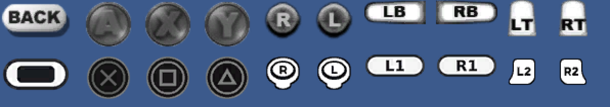

# DualShock 4 icon pack

Redraws the Xbox button icons as PlayStation ones, in two of the game's files:

- `game\naruto.bf`: the font's button glyphs and the large HUD buttons.
- `game\Naruto_clip.SRA`: the 443 button images the menus and HUD draw (they are Scaleform movies), such as the BACK/OK hints and the "Talk" prompt.

It also renames the Xbox services in the menu text (`naruto.bf`, in English, French, Spanish, Italian and German, plus the Japanese placeholder table, which holds the English text): Xbox LIVE becomes PSN ("Online PSN"), Xbox LIVE Marketplace becomes PlayStation Store, Xbox 360 Hard Drive / Memory Unit become PS4 System Storage / USB Storage Device, the Xbox 360 Controller becomes the DUALSHOCK 4 Controller and the Xbox Guide button the PS button. The old help web address is left as it is.

The game takes the menu text from the DLC packs when they are installed: the runtime unpacks them into `Documents\narutorise\0000000000000000\555307E5\00000002\`, and `Naruto_DLC2.bf` and `Naruto_DLC3.bf` there each carry a full copy of the text. The installer patches those too, backing each up to `<name>.ds4bak` first; `restore` puts them back.


| Xbox icon | Becomes |
| --- | --- |
| A / B / X / Y | ✕ / ○ / □ / △ |
| Shoulder L / R (`<lt>`/`<rt>`, and `<lb>`/`<rb>` without the code mod) | L2 / R2 |
| The font's French, Spanish and Italian shoulder icons (the code mod's `<lb>`/`<rb>`) | L1 / R1 |
| Left / right stick | L / R stick |
| The large A/B/X/Y HUD buttons | ✕ / ○ / □ / △ |
| Menu/HUD LB / RB, LT / RT | L1 / R1, L2 / R2 |
| Menu/HUD Back | Touchpad |




It works on its own, with the released port as it is: no build needed. With the DS4 prompts code mod built in, `<lb>`/`<rb>` get their own L1/R1 icons.

## Install

You need [Python 3](https://www.python.org/downloads/) (tick **Add python.exe to PATH**). Close the game, then in this folder run:

```powershell
python ds4_icons.py install "C:\Program Files (x86)\Steam\steamapps\common\NarutoRisePC"
```

Use the folder that has `narutorise.exe` (for the installer's default, `%LOCALAPPDATA%\NarutoRisePC`). The first run copies `game\naruto.bf` to `game\naruto.bf.ds4bak` (about 630 MB) and `game\Naruto_clip.SRA` to `game\Naruto_clip.SRA.ds4bak` (about 70 MB), then patches both in place; their sizes do not change. Running it again does nothing.

- `python ds4_icons.py status "<folder>"` counts the PlayStation and Xbox icons in both files, and the strings still naming Xbox.
- `python ds4_icons.py restore "<folder>"` puts the backups back (Xbox icons).

The installer only changes textures whose bytes match the original game's, so other mods' textures are left alone. If you replace either file (a reinstall, or Steam's file check), run `install` again.

## What's in here

- `ds4_icons.py`: the installer. Plain Python, no packages. It finds the bigfile entries holding the font atlas (`0x2F00E652`) and the HUD buttons (`0x1900001F`, `0x19000024`, `0x1900004E`, `0x1900004F`), pastes the icons into them, LZO-compresses the changed 128 KB chunks again and writes each entry back in its own place (the icons compress better than the originals, so it fits; an entry that would not fit is left alone), updating its size in the file table. The text is one entry per language (`0xFD190232`…`0xFD790232`); the strings are renamed, the text record rebuilt with the new lengths, and the entry compressed again to exactly its old chunk sizes, so nothing else in the file changes. In `Naruto_clip.SRA` each button image (a zlib-compressed DXT5 DDS) is compressed again and written over the original in its own place, and its size in the table is updated.
- `data/`: the icons as raw pixel rectangles plus `manifest.json` (the checksums before and after), and for the menus `clip_icons.zip` (the replacement DDS images, drawn only from Kenney's art) plus `clip_manifest.json`. No game art is included; the installer builds the textures from your own copy.
- `compose_icons.py` and `icons-src/`: how `data/` is made, from [Kenney's Input Prompts](https://kenney.nl/assets/input-prompts) (CC0, see `icons-src/LICENSE-Kenney.txt`). To change the icons: `python ds4_icons.py extract "<folder>" originals`, edit `compose_icons.py`, then `python compose_icons.py originals icons-src data` (needs Pillow).
- `compose_clip.py`, `dxt.py` and `clip_classes.json`: how `clip_icons.zip` is made. `clip_classes.json` says which button each original image shows. `extract` also saves the original menu images into `<out dir>\clip`; then run `python compose_clip.py clip_classes.json originals\clip "<Kenney pack>\PlayStation Series\Double" data` (needs Pillow and the full Kenney pack).

## Limits

- Buttons drawn into the game's videos (such as the quick-time events, `FB_QTE_*.bik`) stay as they are.
- The pack edits the game data, so it shows PlayStation icons with any controller until you `restore`.
